# Lumi App

Mobile app for the JAKA Lumi service robot: status, one-tap commands, driving, map and conversation, on iPhone and
tablets. It works with the robot API on the robot's Jetson Thor.

## Demo

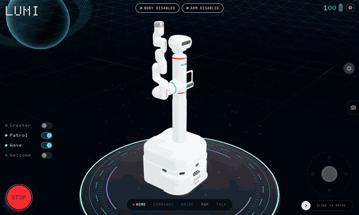

The preview above plays at 3x speed. Full video at normal speed:
[docs/media/lumi-app-demo.mp4](docs/media/lumi-app-demo.mp4) (about 2 minutes).

## Screens

Screenshots were taken on a tablet. The app also fits phones.

### Home

The 3D robot shows the live state of the body and arm. The left side holds the behaviour modes (Greeter, Patrol,
Wave, Welcome), the right side holds the joystick and the camera button, and the red STOP button is always in the
bottom left corner.

| Home | Head and torso cameras |
|---|---|
| 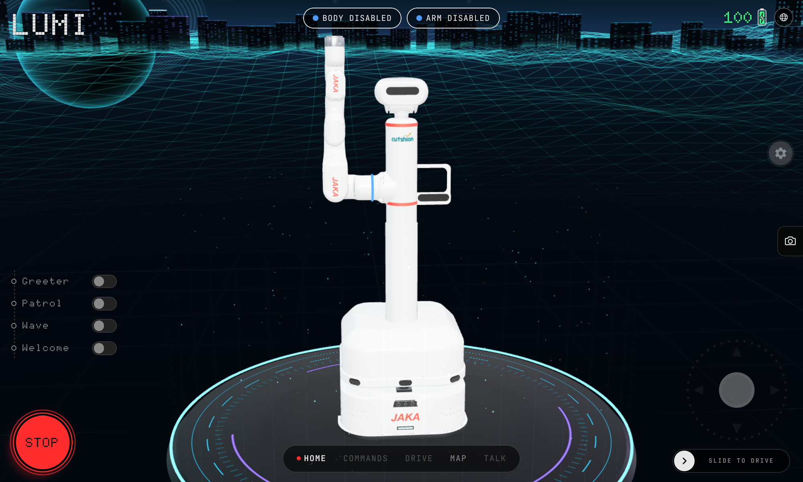 | 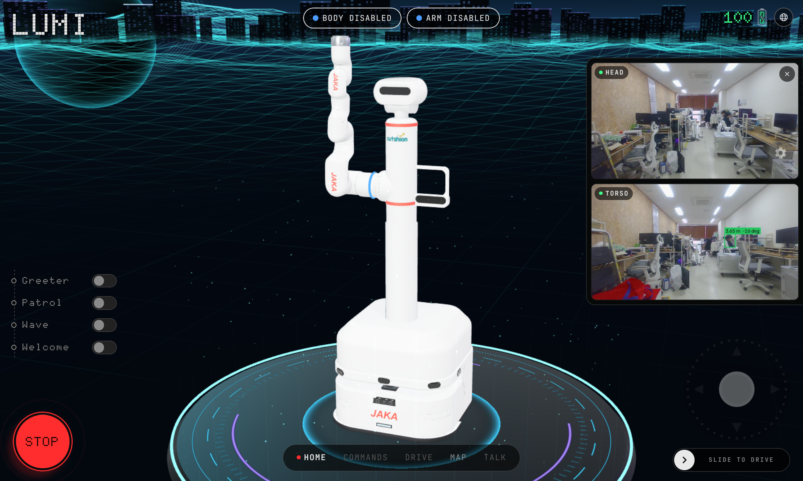 |
| **Drive on, modes running** | **Korean** |
| 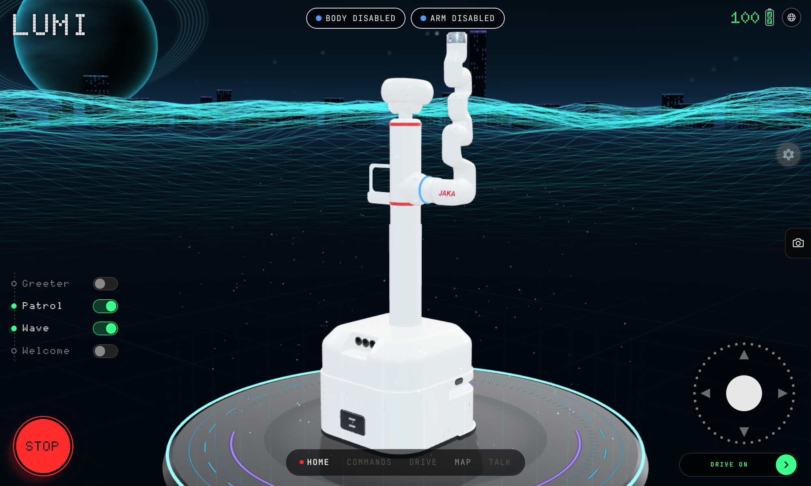 | 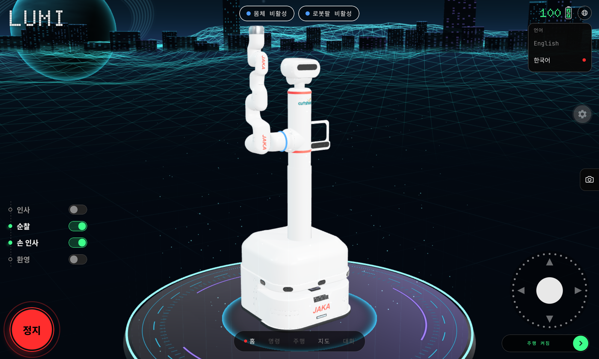 |

### Map

The map is the robot's own sensor map, drawn the same way as the base web page. The top bar has Control, Markers,
Lines, Position, Mapping, Maps and Settings.

| Map | Map with cameras |
|---|---|
| 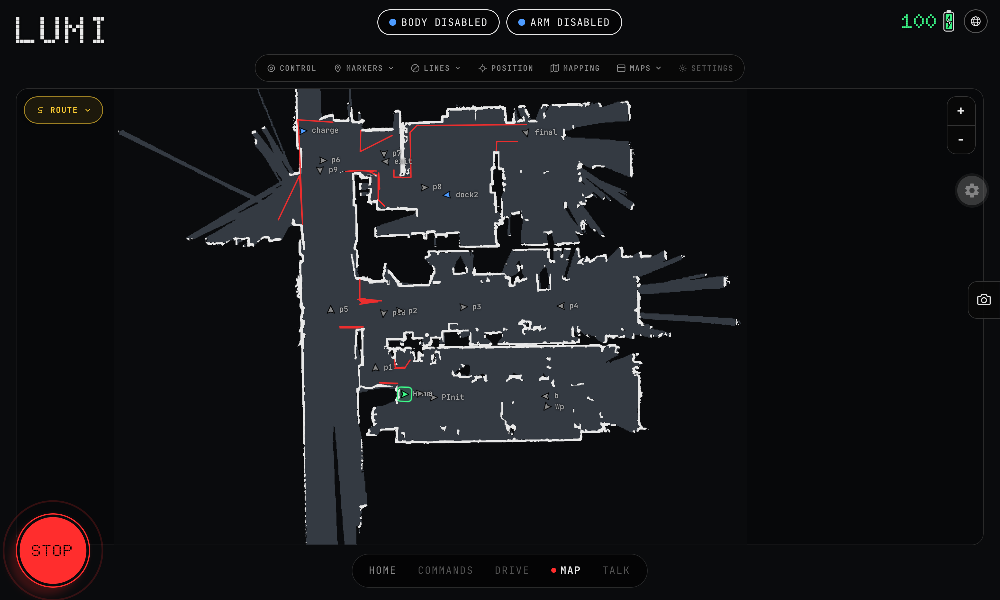 | 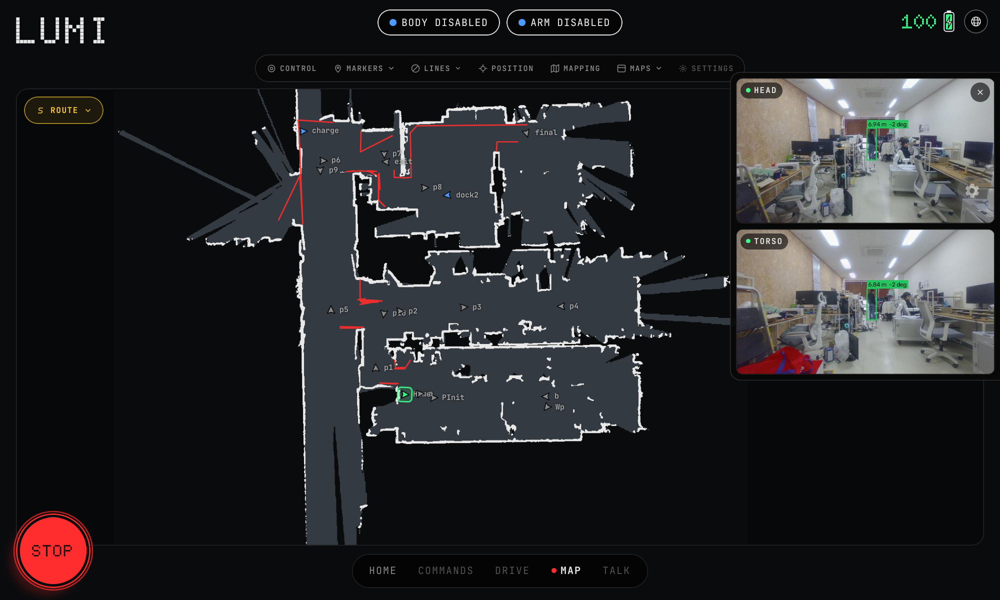 |
| **Driving from the map** | **Saved maps** |
| 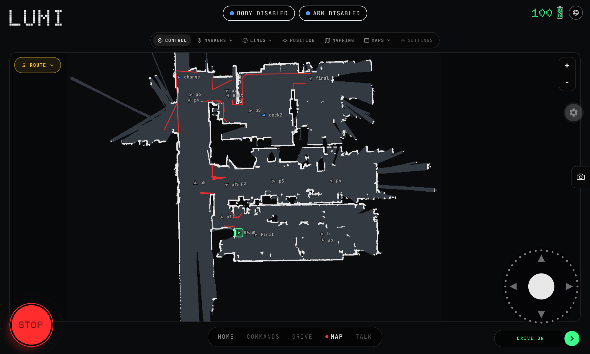 | 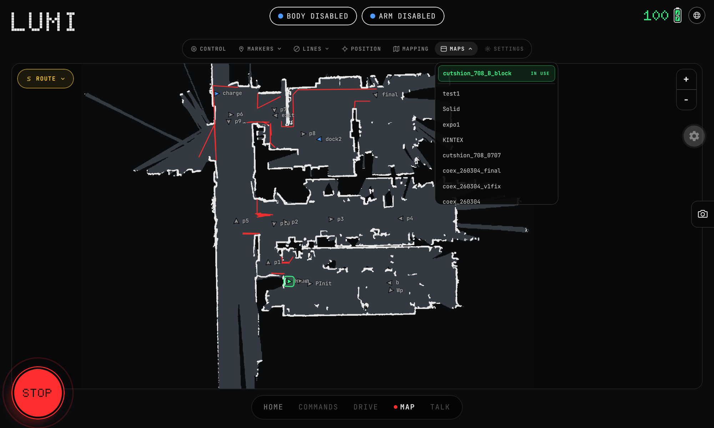 |
| **Route panel** | **Route with stops** |
| 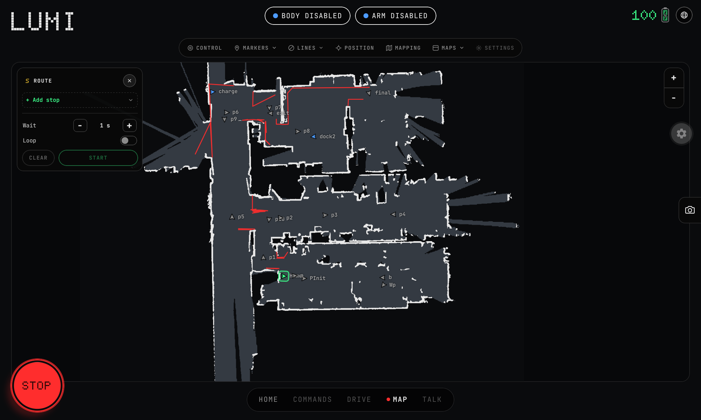 | 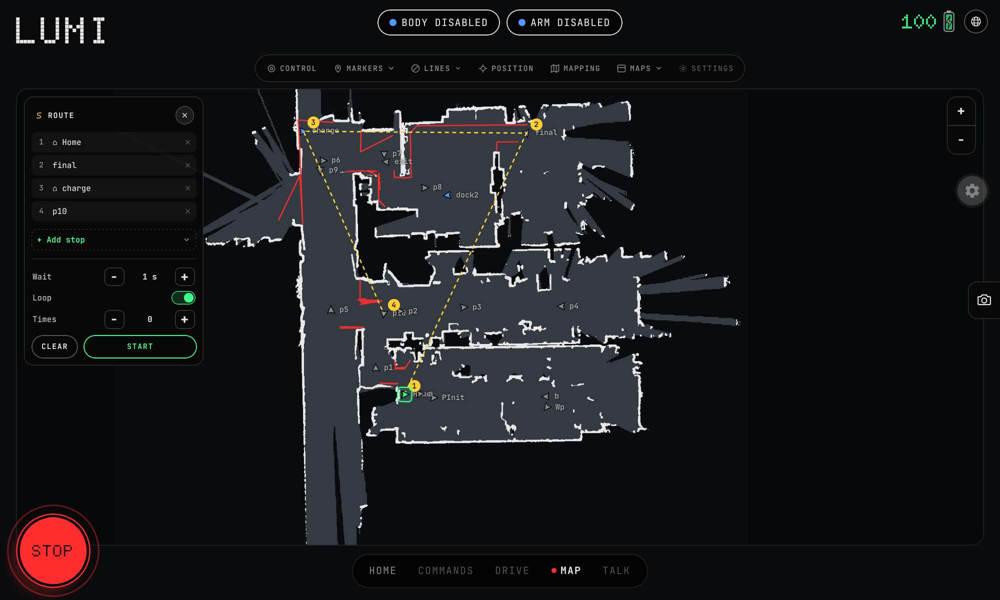 |

### Setting the robot position

Move the purple laser dots onto the walls, then save.

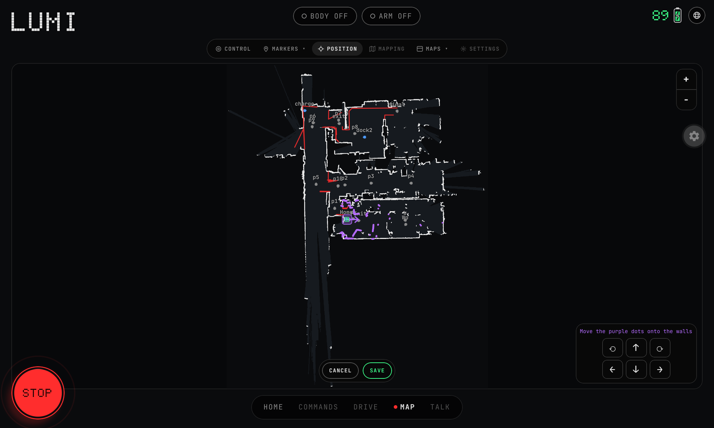

### Earlier versions

| Home | Map |
|---|---|
| 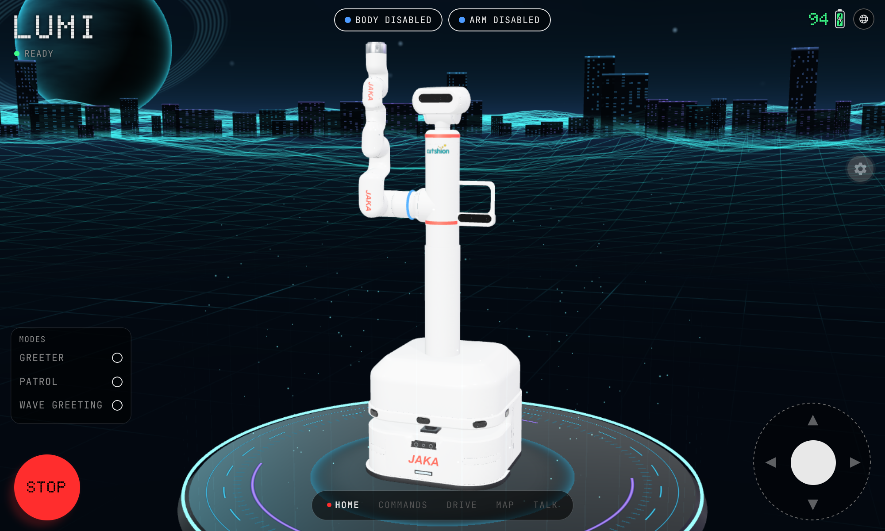 | 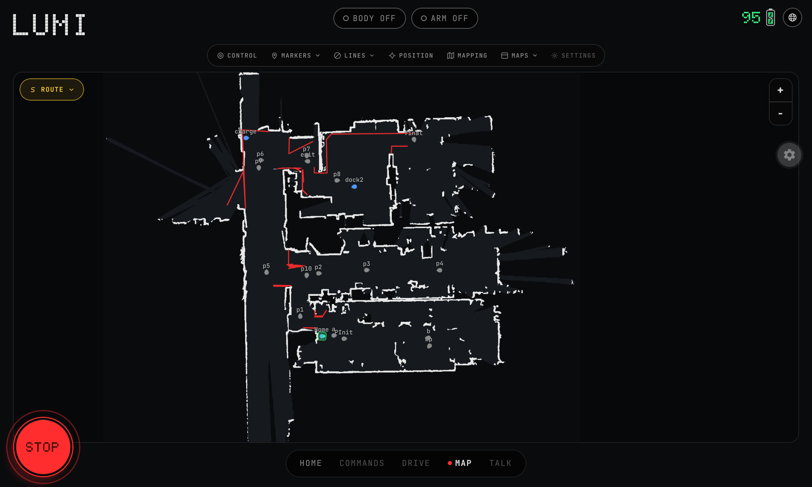 |
